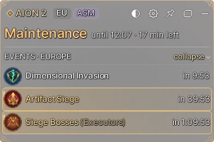
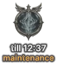

<a href="README.md">Русский</a> · <b>English</b>

# AION2 Status — overlay plugin for AION 2

Server status, boss timers and an interactive map **on top of the game**. Free, no installer, Windows 10/11.

**[⬇ Download the latest version](../../releases/latest)** · [Website](https://aion2status.com/en/) · [Telegram bot](https://t.me/Aion2Status_Bot)

## Features

**Free**
- **Your server's status** — maintenance, starting up, open; ping from your PC to the server and back, AION 2 players online on Steam.
- **Timers** — field bosses from a live player feed, rifts, invasions, Kaira and Nahma, hourly events, event deadlines.
- **Reminders** — sound and a card N minutes and 30 seconds before the start.
- **Map on hover** — where the boss is, the nearest teleport and the route from it; the Abyss for both factions.
- **To chat** — copies a line like "Lagta in 12 min, TP #57"; you paste it into the game chat yourself.
- **Three modes** — full window, compact overlay panel, one-button mini mode.

**Premium · 150 ⭐ (Telegram Stars) for 6 months**
- **Top bar** — the next boss in large type above the game, blinking in the last 30 seconds.
- **Map search** in English and Russian — bosses, teleports, gathering, cubes, traces.
- **Custom marks** with icons, map layers.

Get a key in the [Telegram bot](https://t.me/Aion2Status_Bot): it arrives instantly and is bound to your PC.

## Safety

In short: **the plugin is a normal window drawn over the game.** It never touches the game process or files,
never reads game memory, never presses anything for you and installs no keyboard hooks. No admin rights.

| The plugin does | The plugin does **not** |
|---|---|
| Draws its own window over the game (no-activate style) | Inject into AION2, read or write its memory |
| Reads the last line of the game's `*.breadcrumb.log` to see if you are in the world | Modify game files or touch NCGuard |
| Runs `netstat` to see which server the game is connected to | Send keys or clicks to the game (no SendInput, no macros) |
| Opens one empty TCP connection to the game server every 6–30 s | Install global keyboard or mouse hooks |
| Downloads public feeds: Steam, plaync, shugo.gg, aion2timers | Collect telemetry or send any data about you |

Details: **[SECURITY.md](SECURITY.md)** · every address and how often — **[docs/network.md](docs/network.md)** ·
what is stored where — **[docs/files.md](docs/files.md)** · how to check the file — **[docs/verify.md](docs/verify.md)**.

## Open code

This repository holds **part of the source code** — exactly the parts that show what the plugin does with the
network, the game and your PC:

| File | What's inside |
|---|---|
| [src/Network.cs](src/Network.cs) | Server probes (one empty TCP connect) and HTTP requests to public feeds |
| [src/Ping.cs](src/Ping.cs) | Ping: ICMP, or HTTP round-trip through the tunnel behind a TUN VPN |
| [src/GameDetect.cs](src/GameDetect.cs) | How the plugin learns your server: `netstat` + game log (read-only) |
| [src/FocusGuard.cs](src/FocusGuard.cs) | Why the game never loses the keyboard; focus change log |
| [src/OverlayWindow.cs](src/OverlayWindow.cs) | Window styles: no activation on click, click-through when pinned |
| [src/DeviceCode.cs](src/DeviceCode.cs) | Device code for the key (a hash, not the MachineGuid itself) |
| [src/Update.cs](src/Update.cs) | Updates: signature and SHA-256 checked before install, https and allowed hosts only |
| [src/Hotkeys.cs](src/Hotkeys.cs) | Hotkeys via RegisterHotKey — no keyboard hooks |
| [src/app.manifest](src/app.manifest) | `asInvoker` — no admin rights |

The rest (UI, map, schedule, keys) stays closed so nobody re-publishes the plugin under another name.
Excerpts are refreshed with every release. License: [LICENSE](LICENSE) — you may read and audit, not copy or redistribute.

## Install

1. Download `AION2-Status.zip` from [Releases](../../releases/latest) and unzip it anywhere.
2. Run `AION2-Status.exe`. If Windows shows a blue SmartScreen window — "More info" → "Run anyway".
3. Pick your faction. In the game, set the display mode to "Borderless windowed".

The interface follows your Windows language (English / Russian); switch it in ⚙ → «Язык / Language».
A short guide is inside the zip (`How to use.txt`).

## Questions and bugs

- Bug or idea — [Issues](../../issues).
- Vulnerability — not in Issues, privately: see [SECURITY.md](SECURITY.md).
- Support and Premium — [@Aion2Status_Bot](https://t.me/Aion2Status_Bot).

---

AION2 Status is a fan project, not affiliated with NCSOFT. AION is a trademark of NCSOFT Corporation.
