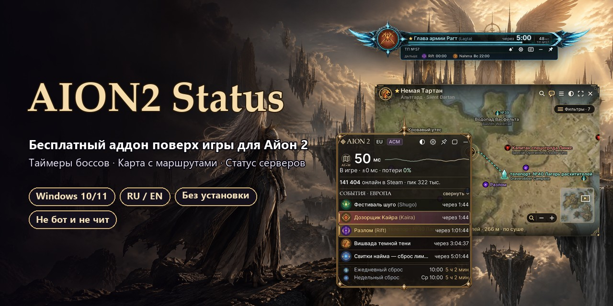
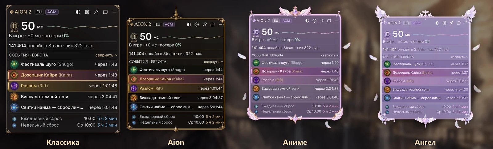
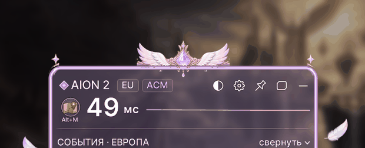
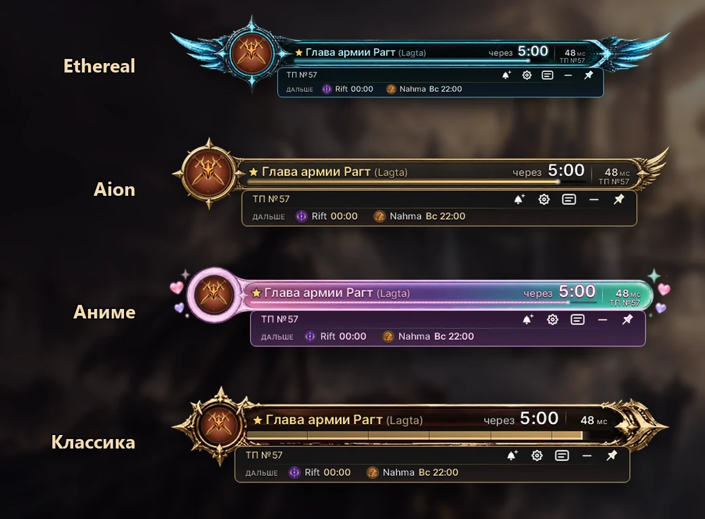

<a href="README.md">English</a> · <b>Русский</b>

# AION2 Status — аддон для Айон 2: таймеры боссов, карта с маршрутами, статус серверов

**AION2 Status** — бесплатный **аддон (плагин) для AION 2** поверх игры: **таймеры полевых боссов** по живой ленте,
**интерактивная карта Айон 2 с маршрутом от ближайшего телепорта**, **боссы Бездны**, разломы и вторжения,
напоминания со звуком, статус серверов и пинг. Global / EU, Steam, русский и английский интерфейс.
**Не бот и не чит:** не трогает процесс игры, её память и сетевые пакеты.

**[⬇ Скачать последнюю версию](../../releases/latest)** · [Сайт](https://aion2status.com) ·
[Telegram-бот](https://t.me/Aion2Status_Bot) · [Премиум на FunPay](https://funpay.com/lots/offer?id=79758695)

## Четыре темы игровой панели

Классика, **Aion** (золото), **Аниме** и **Ангел** — ⚙ Настройки → Вид → Тема. В аниме-темах вокруг панели медленно
плавают перышки. Строки **Бездны** (Кайра, Нахма, боссы осады, Агро) — на своём багрово-лиловом фоне.
Панель тянется за шапку, размер — за любой край: от 3 до 10 событий.

## Котик напомнит о боссе

В аниме-темах, когда подходит время босса с колокольчиком 🔔, из-за рамки выплывает котик с маленьким облачком —
«Король духов Агро · через 5 мин · 15:30» — и потом прячется. Никаких больших окон поверх игры.

## Полоса сверху — ближайший босс над игрой

Ближайший босс крупно над игрой, мигает в последние 30 секунд, номер телепорта (TP №), что дальше.
Четыре темы: Ethereal, Aion, Аниме, Классика (Премиум).

## Интерактивная карта Айон 2 с маршрутами от телепорта

Навёл на строку — рядом с панелью маленькая карта: где босс, ближайший телепорт (TP №) и маршрут от него,
для обеих фракций и Бездны. Клик — большая карта с фильтрами, поиском и своими метками.

## Что умеет

**Бесплатно**
- **Статус твоего сервера** — техработы, запуск, «открылся»; пинг от твоего ПК до сервера и обратно, онлайн игры в Steam.
- **Таймеры** — полевые боссы по живой ленте игроков, разломы, вторжения, Кайра и Нахма, ежечасные события, ежедневный и недельный сброс.
- **Напоминания** — звук и карточка (или котик) за N минут и за 30 секунд до начала.
- **Карта при наведении** — где босс, ближайший телепорт и маршрут от него; Бездна для обеих фракций.
- **«В чат»** — строка вида «Лагта через 12 мин, TP №57» копируется, вставляешь в чат игры сам.
- **Режимы** — основное окно, компактная панель поверх игры с четырьмя темами, одна кнопка.

**Премиум** — **от 1 дня до 12 месяцев**: [FunPay](https://funpay.com/lots/offer?id=79758695) (код активации приходит
сразу) или 100 ⭐ в [Telegram-боте](https://t.me/Aion2Status_Bot)
- **Полоса сверху** — ближайший босс над игрой, четыре темы.
- **Поиск по карте** на русском и английском — боссы, телепорты, сбор, кубы, следы.
- **Свои метки** с иконками и «маршрут сюда», слои карты: именные монстры, подземелья, руда, самоцветы, травы, торговцы.

Активация: ⚙ Настройки → Премиум → **«Ввести код или ключ…»** — вставь код `A2-…`, ключ сам привяжется к твоему ПК.

## Безопасность

Коротко: **плагин — обычное окно поверх игры.** Он не трогает процесс и файлы игры, не читает её память,
ничего не нажимает за тебя и не ставит хуков клавиатуры. Права администратора не нужны.

| Плагин делает | Плагин **не** делает |
|---|---|
| Рисует своё окно поверх игры (стиль «не забирать фокус») | Не внедряется в процесс AION2, не читает и не пишет его память |
| Читает последнюю строку журнала игры `*.breadcrumb.log` — понять, в мире ли ты | Не меняет файлы игры и не трогает NCGuard |
| Смотрит `netstat` — к какому серверу подключена игра | Не отправляет нажатия клавиш и мыши в игру (нет SendInput, макросов) |
| Делает пустое TCP-подключение к серверу игры раз в 6–30 с | Не ставит глобальных хуков клавиатуры и мыши |
| Скачивает публичные ленты: Steam, plaync, shugo.gg, aion2timers | Не собирает телеметрию, не шлёт данные о тебе |

Подробно: **[SECURITY.md](SECURITY.md)** · все адреса и частота запросов — **[docs/network.md](docs/network.md)** ·
что и где хранится — **[docs/files.md](docs/files.md)** · как проверить файл — **[docs/verify.md](docs/verify.md)**.

## Открытый код

Здесь лежит **часть исходного кода** — ровно то, по чему видно, что плагин делает с сетью, игрой и компьютером:

| Файл | Что внутри |
|---|---|
| [src/Network.cs](src/Network.cs) | Пробы серверов (одно пустое TCP-подключение) и HTTP-запросы к лентам |
| [src/Ping.cs](src/Ping.cs) | Пинг: ICMP, а за VPN с TUN — время ответа HTTP через туннель |
| [src/GameDetect.cs](src/GameDetect.cs) | Как плагин узнаёт твой сервер: `netstat` + журнал игры (только чтение) |
| [src/FocusGuard.cs](src/FocusGuard.cs) | Почему игра не теряет клавиатуру; журнал смены фокуса |
| [src/OverlayWindow.cs](src/OverlayWindow.cs) | Стили окна: не активируется по клику, пропускает мышь в закреплённом виде |
| [src/DeviceCode.cs](src/DeviceCode.cs) | Код устройства для ключа (хэш, не сам MachineGuid) |
| [src/Update.cs](src/Update.cs) | Обновления: подпись и SHA-256 проверяются до установки, только https и разрешённые адреса |
| [src/Hotkeys.cs](src/Hotkeys.cs) | Горячие клавиши через RegisterHotKey — без хуков клавиатуры |
| [src/app.manifest](src/app.manifest) | `asInvoker` — без прав администратора |

Весь остальной код (интерфейс, карта, расписание, ключи) закрыт, чтобы плагин не скопировали и не выпустили
под чужим именем. Выдержки обновляются с каждым релизом. Лицензия — [LICENSE](LICENSE): смотреть и проверять можно,
копировать и распространять нельзя.

## Установка

1. Скачай `AION2-Status.zip` из [Releases](../../releases/latest) и распакуй в любую папку.
2. Запусти `AION2-Status.exe`. Если Windows покажет синее окно — «Подробнее» → «Выполнить в любом случае».
3. Выбери фракцию. В игре поставь режим экрана «Оконный без рамки».

Короткий гайд — в архиве (`Как пользоваться.txt` / `How to use.txt`).

## Частые вопросы

**Могут ли забанить?** AION2 Status — обычное окно поверх игры: не внедряется в игру, не читает её память и пакеты,
ничего не нажимает за тебя — см. [Безопасность](#безопасность) и открытый код выше.

**Какие серверы и языки?** AION 2 Global / EU (Steam), обе фракции. Интерфейс на русском и английском.

**Это бесплатно?** Да: таймеры, напоминания, статус серверов, карта при наведении, строки для чата и все четыре
темы панели. Премиум добавляет полосу сверху, поиск по карте, свои метки и доп. слои карты.

**Как ввести код с FunPay?** ⚙ Настройки → Премиум → «Ввести код или ключ…», вставь `A2-XXXX-XXXX-XXXX`.

## Вопросы и ошибки

- Ошибка или идея — [Issues](../../issues).
- Уязвимость — не в Issues, а лично: см. [SECURITY.md](SECURITY.md).
- Поддержка и Премиум — [@Aion2Status_Bot](https://t.me/Aion2Status_Bot).

---

AION2 Status — фанатский проект, не связан с NCSOFT. AION — товарный знак NCSOFT Corporation.
